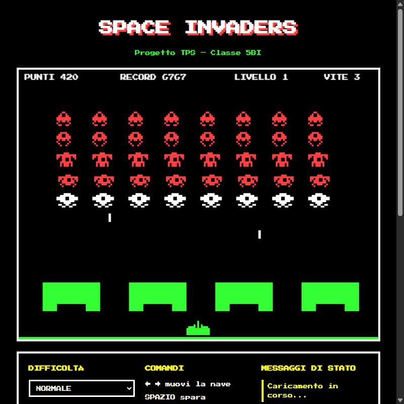

# Progetto TPS — Space Invaders

Ricreazione di **Space Invaders** come pagina web interattiva, in **HTML, CSS e JavaScript puro**, senza framework.

**Team classe 5BI** — Elisey Rotar · Verde Giulio Enea



## Come eseguire

La classifica viene caricata con `fetch`, quindi serve un server locale (il doppio clic sul file non basta):

```bash
cd space-invaders
python -m http.server 8000
# poi apri http://localhost:8000
```

## Comandi

| Tasto | Azione |
|---|---|
| `←` `→` | muovi la navicella |
| `SPAZIO` | spara (un colpo per volta) |
| `P` o bottone **PAUSA** | pausa / riprendi |

Dal pannello si sceglie la difficoltà (facile / normale / difficile) e a fine partita si salva il punteggio in classifica.

## Struttura

```
.
├── README.md
├── consegna/                    ← traccia (PDF) e tabella di monitoraggio
└── space-invaders/
    ├── index.html               ← la pagina
    ├── style.css                ← lo stile
    ├── js/
    │   ├── disegni.js           ← disegna sul canvas
    │   ├── gioco.js             ← logica: movimento, collisioni, tasti
    │   └── classifica.js        ← parte asincrona (async/await)
    ├── dati/highscores.json     ← classifica di partenza
    ├── img/sprites.png          ← sprite pixel art
    ├── fonts/                   ← font pixel
    └── docs/                    ← screenshot
```

## Requisiti della traccia

| # | Requisito | Dove |
|---|---|---|
| 1 | HTML ordinato | `index.html`: `header`, `main`, `section`, `footer` |
| 2 | CSS curato | `style.css` |
| 3 | Manipolazione DOM | messaggi di stato e classifica creati e rimossi da JavaScript |
| 4 | Funzioni chiare | `muoviInvasori()`, `controllaProiettili()`, `avviaPartita()`, ... |
| 5 | Almeno 3 eventi | `keydown`/`keyup`, `click`, `submit`, `change` |
| 6 | Interazione utente | nome, difficoltà, pausa, salvataggio punteggio |
| 7 | `async` / `await` | `caricaClassifica()` e `salvaPunteggio()` in `classifica.js` |
| 8 | Messaggi di stato | "Caricamento in corso…", "Operazione completata…", "Errore nel caricamento…" |

## Sincrono e asincrono

- **Sincrono** (`gioco.js`, `disegni.js`): un ciclo `requestAnimationFrame` aggiorna e ridisegna il gioco circa 60 volte al secondo.
- **Asincrono** (`classifica.js`): `await fetch('dati/highscores.json')` carica la classifica e il salvataggio simula 800 ms di attesa, con i messaggi di stato mentre si aspetta.

## Crediti

| Asset | Autore | Licenza |
|---|---|---|
| Sprite "Alternate Space Invaders" | WaffleKilometer (OpenGameArt.org) | CC0 |
| Font Press Start 2P | CodeMan38 | SIL OFL |

Il codice è scritto da noi.
